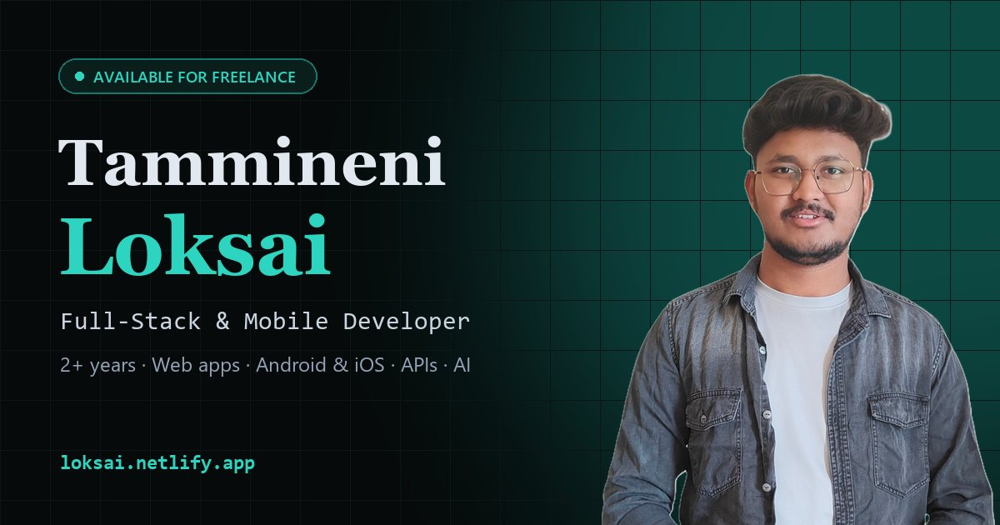

# Tammineni Loksai — Portfolio

[](https://github.com/TLoksai/Loksai_Portfolio/actions/workflows/ci.yml)

Personal portfolio of **Tammineni Loksai**, a full-stack & mobile developer from Bengaluru with 2+ years of experience shipping web apps, Android & iOS apps, APIs and automation. Available for freelance projects.

**Live:** https://loksai.netlify.app



## Highlights

- **Fast, single-page React app.** Client-side routing, per-page titles, scroll-to-section links and a custom 404 page.
- **Content-driven.** Every experience entry, project, skill and freelance offer lives in one typed file: [`src/data/portfolio.ts`](src/data/portfolio.ts).
- **Responsive.** Layouts are tuned for phones, tablets and desktops. Desktop-only photos are served through `<picture>` so phones never download them.
- **Accessible.** Lighthouse accessibility 100, labelled form fields and icon buttons, WCAG AA text contrast, and `prefers-reduced-motion` support.
- **Contact form on Netlify Forms.** Includes a honeypot spam trap, with no backend to maintain.
- **Lean.** About 300 KB per page, with WebP images and fingerprinted assets cached for a year.
- **Hardened.** Security headers (`X-Frame-Options`, HSTS, `nosniff`, `Referrer-Policy`, `Permissions-Policy`) via [`public/_headers`](public/_headers).

## Tech stack

| Area | Tools |
|---|---|
| UI | React 18, TypeScript, Tailwind CSS 3, react-icons, lucide-react |
| Routing | React Router 7 |
| Build | Vite 6 |
| Quality | ESLint (typescript-eslint), `tsc` type-check, Lighthouse CI |
| Hosting | Netlify (static hosting, Forms, headers, SPA redirects) |
| Analytics | Google Analytics 4 |

## Getting started

Requires Node.js 20 or newer (CI uses Node 24).

```bash
npm ci          # install exact versions from package-lock.json
npm run dev     # start the dev server on http://localhost:5173
npm run build   # type-check and build to dist/
npm run preview # serve the production build locally
npm run lint    # run ESLint
```

## Project structure

```
src/
  data/portfolio.ts     # all site content: experience, projects, skills, freelance info
  pages/                # page sections (hero, experience, projects, freelance, contact, …)
  pages/shared/         # header and footer
  App.tsx               # routes, per-page titles, scroll handling
public/
  images/               # optimised WebP photos and project screenshots
  _headers, _redirects  # Netlify headers and SPA fallback
  robots.txt, sitemap.xml, og-image.jpg, favicons
```

### Editing content

Update [`src/data/portfolio.ts`](src/data/portfolio.ts) and the home, About, Projects and Skills pages all pick it up. To add a project, append an entry to `PROJECTS`. Set `featured: true` to show it on the home page, and put a screenshot (WebP, about 960px wide) in `public/images/projects/`.

## Deployment

Netlify builds and deploys every push to `main` (build command `npm run build`, publish directory `dist`).

The contact form uses [Netlify Forms](https://docs.netlify.com/forms/setup/). A hidden copy of the form in `index.html` lets Netlify detect it at deploy time. Form detection and email notifications are enabled in the Netlify dashboard under **Forms**.

## CI

[`.github/workflows/ci.yml`](.github/workflows/ci.yml) runs on every push and pull request:

1. **Lint, type-check and build**
2. **Production dependency audit:** `npm audit --omit=dev`
3. **Lighthouse CI:** fails if accessibility or SEO drop below 95, or best practices below 90

## Contact

- Email: [loksai2024@gmail.com](mailto:loksai2024@gmail.com)
- LinkedIn: [tammineniloksai](https://www.linkedin.com/in/tammineniloksai/)
- GitHub: [TLoksai](https://github.com/TLoksai)
